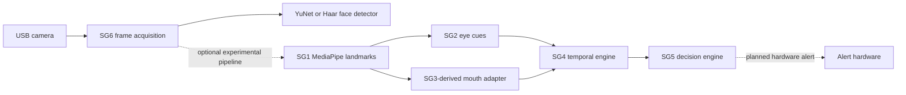
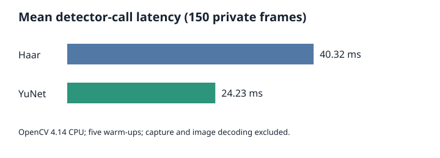

# SG6 Stage 1 Midterm Technical Report

**CS477 — Computer Vision**  
**Project:** Driver Drowsiness Detection  
**Subgroup:** SG6 — Embedded Deployment and System Integration  
**Platform:** NVIDIA Jetson Orin Nano Developer Kit, 8 GB  
**Evidence review:** 28 October 2026  
**Repository:** [CV_Drowsinees_Detection](https://github.com/Sananismm/CV_Drowsinees_Detection), branch sg6-week5-integration, HEAD b4bf9ec; the worktree contains uncommitted additions.  
**University and team members:** not independently established; intentionally omitted.

## Executive summary

SG6 provides camera acquisition, two face-detector choices, runtime measurements, private evidence handling and integration experiments. On 150 identical private frames, YuNet and Haar each detected at least one face in all frames; mean timed detector calls were 24.23 ms and 40.32 ms respectively. These are unlabelled coverage results, not accuracy. Four synthetic current-snapshot integration tests passed on 28 October, as did seven demo tests. A historical Haar live-camera result exists, but the revised demo's live success and GUI have not been verified in the recorded assistant session. A documented 120-frame integrated-video observation is not independently backed by a run log in the reviewed evidence. Readiness is **partial**, pending a fresh live run and interface-owner review.

## 1. Introduction

Driver monitoring seeks evidence of reduced alertness from visual behaviour over time. Edge execution can reduce dependence on connectivity and support local processing; real-time capture also imposes latency, resource and continuity constraints. SG6's remit is embedded deployment, camera handling, measurement and integration, while the detection and behavioural algorithms belong to their respective subgroups. No medical or safety performance is established.

## 2. System requirements

The user-supplied Stage 1 brief requires a real camera/face detector demonstration, comparative performance, tests and interface readiness. The implementation requests 640×480, supports camera selection, a headless mode, clean shutdown and optional metrics. The recorded comparison is on identical frames; a project-wide minimum FPS, accuracy target, operating temperature and maximum latency were not supplied. The design seeks stable processing on ARM64 and preserves private frames locally. Subgroup data must retain frame identity and consistent capture-time units; missing cues must not be treated as reliable normal observations.

## 3. Hardware and software configuration

| Item | Evidence and qualification |
|---|---|
| Target | Jetson Orin Nano developer kit, 8 GB as project specification; ARM64 Tegra kernel observed. |
| Jetson Linux | R36.4.7 observed in current host release file; earlier saved environment report dated 26 October records R36.4.3. Do not conflate them. |
| Ubuntu | 22.04 specified in brief; current OS release not independently rechecked here. |
| Python | 3.10.12 in saved environment report; demo venv at ~/sg6-yunet-env. |
| OpenCV | 4.14.0 and NumPy 2.2.6 observed in demo venv; system Python reported OpenCV 4.5.4. System OpenCV lacks cv2.data in this environment and caused Haar tests to fail. |
| Integrated environment | Separate embedded_6/.venv-integrated; manifest pins NumPy 1.26.4, opencv-contrib-python 4.10.0.84 and MediaPipe 0.10.18; PyYAML range. Installed versions not independently rechecked during this documentation turn. |
| Camera | A4Tech FHD USB camera appeared in USB enumeration, with video0 and video1 in sysfs. Sandbox hid device nodes; actual open from revised demo not verified. |
| Detector/model | OpenCV FaceDetectorYN and models/face_detection_yunet_2023mar.onnx; alternative OpenCV frontal Haar cascade. |
| Acceleration | OpenCV reported zero CUDA-enabled devices in the earlier audit. Benchmark explicitly requests no CUDA and uses default CPU; no GPU acceleration claimed. |

## 4. System architecture

The solid detector branch is implemented in Integration/run_midterm_demo.py; live success for the current revision is pending. The independent Integration/run_integrated.py uses SG1's MediaPipe landmarks and copied subgroup modules; synthetic integration is verified, video execution is documented, and live capture-to-decision remains unverified. The SG3-derived adapter is an experimental replacement, not the full SG3 live module. Hardware alerts are not verified. See [interfaces](SG6_INTEGRATION_INTERFACES.md).

## 5. Face detection algorithms

YuNet is a neural-network face detector executed by OpenCV FaceDetectorYN with the 2023 March ONNX model. It emits boxes, five keypoints and scores. The code uses score threshold 0.6, NMS 0.3 and top-k 5000. Five coarse points cannot supply SG2's six points per eye for EAR. Haar uses grayscale conversion and a pretrained cascade with scale factor 1.1, five neighbours and 40×40 minimum window. It supplies boxes but no landmarks or confidence. Both are established OpenCV choices and allow a classical-versus-neural CPU comparison; the private trial alone cannot establish relative accuracy or general robustness.

## 6. Implementation

Integration/run_midterm_demo.py creates one detector, opens the V4L2 camera, requests 640×480 and reports dimensions of each actual frame. detect() changes YuNet input size per frame or converts to grayscale for Haar; perf_counter surrounds that detector function. Overlays show status, count, processing FPS and latency; YuNet adds confidence and five points. Tk displays encoded frames locally; headless prints status. A monotonic elapsed interval supports cumulative processing FPS. summarize() calculates mean, median, coverage and failed reads; dropped frames are unknown. --save-metrics writes JSON to ignored evidence/ by default, not camera imagery. --camera, --detector, --headless, --duration, --frames, --output-dir and --save-metrics are documented in --help. Capture is released in finally; open, read, missing-model and GUI failures return errors. Ctrl+C exits cleanly. Latency samples are retained for the exact median, so unbounded runs grow memory gradually. The demo contains no drowsiness decision.

## 7. Experimental methodology

Integration/benchmark_detectors.py reads 150 private frame_*.jpg files, loads them once, then runs both detectors on the same in-memory 640×480 frames. It performs five warm-up calls on the first frame for each detector, then times every call using perf_counter. Haar timing includes grayscale conversion; YuNet includes input-size setup. Image decode, capture and application display are excluded. Haar runs before YuNet, so order and thermal effects are uncontrolled. Configuration and results are saved in private evidence/detector_benchmark.json. Lighting, subject count, camera conditions, ground-truth labels, repetitions, temperature and power mode are not recorded; coverage cannot quantify false positives or missed faces when a frame contains more than one person.

## 8. Results and performance evaluation

| Measure | Haar | YuNet | Interpretation |
|---|---:|---:|---|
| Frames with ≥1 detection | 150/150 | 150/150 | Coverage on the same unlabelled private frames |
| Mean detector-call time | 40.32 ms | 24.23 ms | Includes preprocessing described above |
| Inference throughput | 24.80 FPS | 41.27 FPS | Frames divided by total measured detector-call time |
| Median detector-call time | unavailable | unavailable | Benchmark does not save per-frame timings |
| Revised demo live processing FPS | unavailable | unavailable | No successful run log for this revision |
| Detector execution on recorded sample | passed | passed | Demo test run on 28 October |
| Resource use under workload | unavailable | unavailable | No workload measurement located |

The historical evidence/face_detection_results.json records an earlier separate Haar camera run: 150 processed, 135 with a detection, mean detection 46.95 ms and end-to-end 18.04 FPS. The corresponding test_live_face_detection.py times detectMultiScale after grayscale conversion and saves a private image. Its JSON lacks a timestamp, actual resolution and runtime configuration; it is not comparable to the updated benchmark or proof that the revised demo ran live. A prior readiness note reports a five-frame YuNet user run but no original output log was located. The revised sandbox attempts returned camera-open errors and zero frames; sysfs showed the camera, so this is a sandbox access limitation, not evidence that hardware was absent or faulty.

## 9. Subgroup integration

The integrated snapshot attributes subgroup files to main a5570c4 and the SG3-derived adapter; its branch audit identifies source revisions. SG1 emits a validated sg1.v1 record with frame_id, timestamp_ms, image size, 478 normalized landmarks, face box, status and nullable confidence. SG2 maps landmarks to pixel geometry and EAR, uses OPEN/CLOSED/UNKNOWN, and maps milliseconds to seconds. SG3's copied adapter estimates mouth geometry and yawn events; its hard observation is not a calibrated probability. SG4's proposed sg4.input.v1 contains face, eye, mouth and head blocks, while SG5-side bridge handles missing calibrated confidences using availability. SG4 output v1.1 supplies time_s, fractional perclos, face_valid, eye_closure_s, long_blinks and yawn_count; the earlier notebook uses 0–100 PERCLOS. SG5 adds status-aware NORMAL/WARNING/DROWSY output; insufficient/stale data must not be treated as normal. Detailed contracts, confidence caveats and pending approvals are in [interfaces](SG6_INTEGRATION_INTERFACES.md). Binary hard-state closure fraction is not validated P80 occlusion.

## 10. Verification and test results

The following outcomes were observed on 28 October in the prior implementation session; the current documentation turn could not rerun shell tests because of a sandbox mount error.

| Test | Input and expected outcome | Outcome and evidence | Command |
|---|---|---|---|
| Demo tests | Synthetic blank and mocked capture; recorded frame; expected loader, metrics, cleanup | PASS, 7 tests; real detector calls on available sample, no live acquisition | `~/sg6-yunet-env/bin/python -m unittest discover -s embedded_6/Integration -p test_midterm_demo.py -v` |
| Current integration | Synthetic SG1 landmarks, invalid identity/geometry, missing face, closure and yawn; preserve identity and conservative state | PASS, 4 tests; integrated/tests/test_pipeline.py | `embedded_6/.venv-integrated/bin/python -m unittest discover -s embedded_6/integrated/tests -v` |
| Legacy SG2→SG4 | Controlled EAR values; temporal PERCLOS and closure | PASS; synthetic, older reference modules | `python3 embedded_6/Integration/test_sg2_sg4.py` |
| Legacy SG5 | Controlled temporal values including missing face | PASS; synthetic, older reference module | `python3 embedded_6/Integration/test_sg5.py` |
| Mock interface validator | Existing fixture structure and aligned IDs/times | PASS for fixtures only; warnings for empty landmark lists | `python3 embedded_6/Integration/validate_interfaces.py` |
| Same-frame benchmark | 150 private frames; both detectors | PASS; saved detector_benchmark.json | `~/sg6-yunet-env/bin/python embedded_6/Integration/benchmark_detectors.py` |
| Revised live demo | Connected camera → real frame and inference | BLOCKED in assistant sandbox, /dev nodes hidden; USB/sysfs detection observed | See [demo guide](SG6_MIDTERM_DEMO_GUIDE.md) |
| Integrated recorded video | Source video through SG1–SG5 | DOCUMENTED in integrated/README.md: 120 frames, ~14 FPS; original run log unavailable, not independently reproduced now | See integrated README |
| GUI success / physical alert | Live display / alert actuation | NOT VERIFIED | No captured evidence |

## 11. Challenges and decisions

System OpenCV 4.5.4 and the isolated build differ; a direct system-Python test failed because cv2.data was absent. Earlier YuNet incompatibility is described in prior project notes, but its original failure log is unavailable; the isolated 4.14 runtime was used successfully on recorded frames. ARM64 support and dependency pinning are reasons to preserve working environments rather than upgrade JetPack. SG1's dense landmarks and YuNet's five points are different contracts. The old SG4 notebook uses percentage PERCLOS, while the newer output uses a fraction. Confidence and unknown values require explicit adapters. Recordings and results are kept under ignored evidence/; avoid committing images.

## 12. Limitations

No representative labelled detection set, independent accuracy statistics, robustness study, thermal/power profile, validated yawn or eye-closure clinical measure, or live camera-to-alert evidence was found. Synthetic tests verify selected logic and fixtures, not accuracy. The optional integrated pipeline is experimental, uses separate dependencies and a pinned MediaPipe model, and requires subgroup approval of adapters, timing and semantics. The 200 ms inherited gap policy can censor events at low throughput. Webcam live demo and GUI need a fresh on-device check. Team identities and university name are not established. Existing outputs and source snapshots are uncommitted and must be reviewed before publication.

## 13. Conclusion

SG6 has demonstrable detector inference on recorded frames, reproducible benchmark code, synthetic integration evidence and a camera application ready for a live check. Evidence is sufficient to discuss a Stage 1 prototype, but not to claim examiner-ready live operation or a fully validated drowsiness system.

## 14. Future work

1. Verify both detectors on the connected camera, GUI, failure recovery and metrics; record duration and FPS.
2. Validate SG1 dense landmarks → SG2 EAR on Jetson, with subgroup owners; test SG3 yawn cues and missing values.
3. Agree SG4/SG5 units, PERCLOS semantics, timestamps, stale data and alert policy; test real handoffs.
4. Test physical alerts and longer runs, then measure power/thermal resources and varied lighting, pose and users with appropriate consent.
5. Refresh pinned snapshots deliberately; complete independent labelled evaluation before final deployment.

## References and evidence

- Repository source paths under ~/CV_Drowsinees_Detection/embedded_6: Integration/run_midterm_demo.py, benchmark_detectors.py, test_midterm_demo.py, run_integrated.py; integrated/tests/test_pipeline.py; integrated/BRANCH_AUDIT.md and README.md; models/README.md; BENCHMARK_RESULTS.md. Private JSON files are not included in this package.
- [OpenCV Zoo YuNet model and MIT license](https://github.com/opencv/opencv_zoo/tree/main/models/face_detection_yunet); Wu, Peng and Yu, “YuNet: A tiny millisecond-level face detector,” Machine Intelligence Research 20 (2023), 656–665. Upstream directory states MIT; confirm the distributed binary's provenance and license when redistributing.
- [OpenCV face detection documentation](https://docs.opencv.org/4.x/d0/dd4/tutorial_dnn_face.html); [OpenCV cascade tutorial](https://docs.opencv.org/4.x/db/d28/tutorial_cascade_classifier.html).
- [NVIDIA Jetson Linux documentation](https://docs.nvidia.com/jetson/archives/r36.4.3/DeveloperGuide/); [MediaPipe Face Landmarker](https://ai.google.dev/edge/mediapipe/solutions/vision/face_landmarker). Check MediaPipe model-specific terms before redistribution; the task model is local and ignored.
- [SG6 commit b4bf9ec](https://github.com/Sananismm/CV_Drowsinees_Detection/commit/b4bf9ec42c8b5aa119eae5f78c7c499665822911). SG2, SG4 and SG5 reference snapshots are attributed in embedded_6/reference_modules/README.md; see integrated/BRANCH_AUDIT.md for the newer copies.

**Fixture provenance clarification:** The SG1 positive landmark fixture used in these controlled tests was generated from an existing tracked SG1 sample image, not generated entirely from artificial landmarks. Tests alter those coordinates and use synthetic frames/scenarios; they do not prove live camera-to-decision operation or accuracy. See the upstream `module_1/scripts/generate_interface_fixtures.py` and `interfaces/examples/sg1_v1_ok.json` on the main branch.
