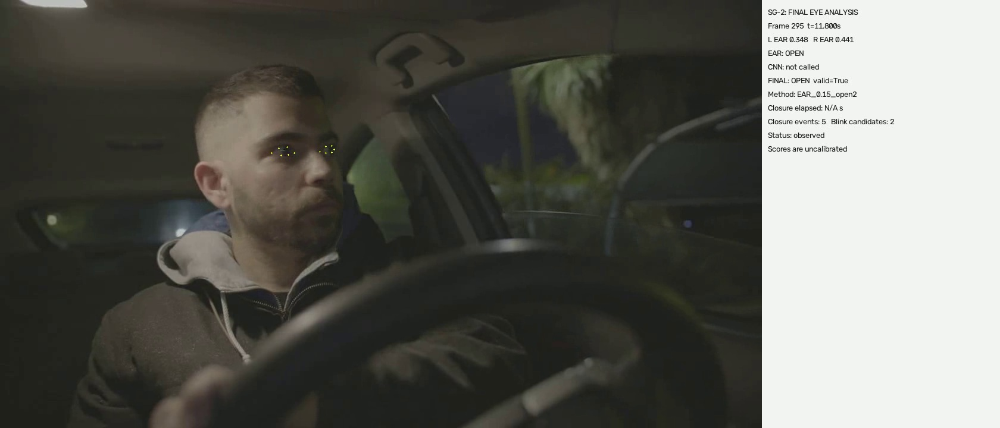
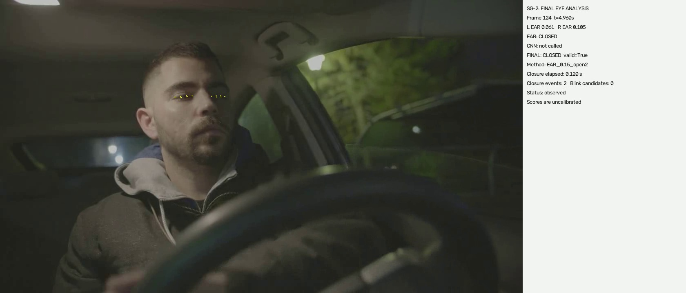
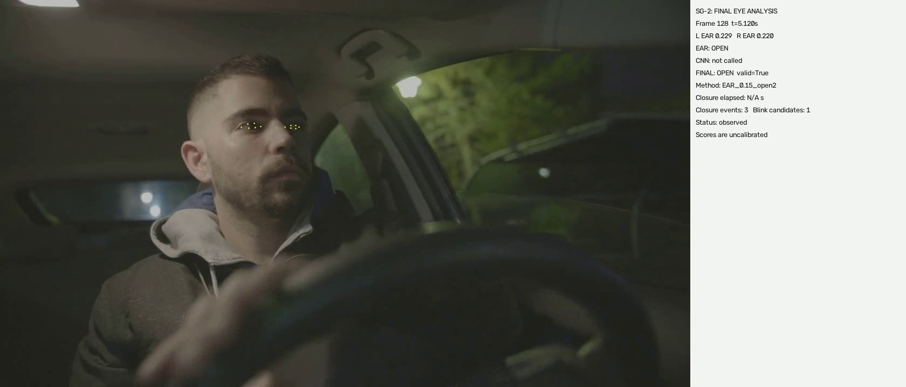
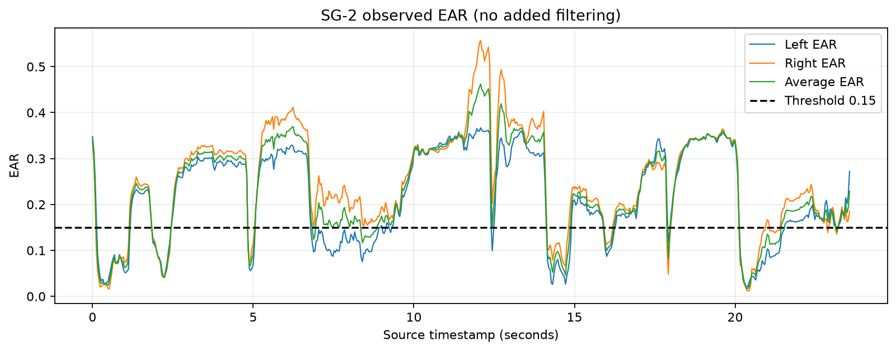

# SG2 — Eye State and Blink Detection

## Overview

SG2 is the eye-state and blink-analysis part of our driver drowsiness detection project. We used the Eye Aspect Ratio (EAR) to estimate whether the eyes were open or closed, then tracked changes over time to find eye closures and blink candidates. SG1 supplies the facial landmarks, and SG4 uses our timestamped output for longer-term analysis. SG2 does not make the final drowsiness decision. [Processor](processor.py) [Module interfaces](SG1_INTEGRATION.md)

## Methodology

The video demo runs the team's SG1 detector on each original frame and passes its landmarks and the same frame to SG2. We calculate left and right EAR, average them, apply the eye-state rule and temporal filter, then update the closure tracker. Annotations are drawn after processing the original pixels. [Video pipeline](demo.py) [Processor](processor.py)

```text
Video frame → SG1 facial landmarks → EAR → filtered eye state
            → closure/blink candidates → SG4 cues and annotated video
```

The current method is **EAR-only**. The CNN and fusion methods remain available for comparison, but CNN inference is disabled in this mode. [Method settings](final_method.json) [Decision rules](fusion.py)

## Eye Aspect Ratio (EAR)

EAR compares the height and width of an eye using six ordered landmarks:

```text
EAR = (distance(p2, p6) + distance(p3, p5)) / (2 × distance(p1, p4))
```

We use the formula described by Soukupova and Cech (2016). Normalized landmark coordinates are scaled by the original image dimensions before calculating distances. We calculate EAR for both eyes and use their average for classification. [EAR paper](https://cmp.felk.cvut.cz/ftp/articles/cech/Soukupova-CVWW-2016.pdf) [Implementation](eye_analysis.py)

The eye indices are left `[33,160,158,133,153,144]` and right `[362,385,387,263,373,380]`, following the SG1 packet order. [Landmark adapter](adapters.py)

## Eye State Classification

| State | Meaning | Code |
|---|---|---|
| OPEN | Raw average EAR is at least 0.15; the final state also follows reopening confirmation. | [Classifier and filter](fusion.py) |
| CLOSED | Raw average EAR is below 0.15; the final state may also remain CLOSED while reopening is being confirmed. | [Classifier and filter](fusion.py) |
| UNKNOWN | Eye geometry is missing or invalid, so no open/closed observation is available. | [Input adapter](adapters.py) |

CLOSED takes effect immediately. When reopening from CLOSED, the filter waits for two observed OPEN frames or the configured 0.08-second bound, checked at incoming frame timestamps. UNKNOWN observations and gaps over 0.2 seconds reset the filter history; a current valid observation can still produce a known state. [Temporal filter](fusion.py)

We kept the EAR threshold at **0.15**. This is a project setting rather than a universal value for every person or recording condition. [Configuration](final_method.json)

## Blink Detection

The tracker groups consecutive valid CLOSED states into a closure interval. Reopening finishes the interval. A complete, uncensored closure lasting **0.1–0.4 seconds** receives a blink-candidate flag once, on the reopening frame. Longer closures are still recorded as closure events. [Closure tracker](events.py)

Missing observations, gaps over 0.2 seconds and end-of-video terminate the current observation as incomplete. If the video begins with closed eyes, the start of that closure is unknown and it is not counted as a complete blink candidate. These flags are predictions, not manually confirmed blinks. [Event rules](events.py)

## Experiments and Method Comparison

We tested EAR thresholding,and EAR with temporal filtering. We selected **EAR with temporal filtering** because the EAR-based methods performed better than the earlier fusion method in our preliminary comparison, without requiring additional CNN inference. This keeps frame-by-frame processing simple, while reopening confirmation is used to make transitions between CLOSED and OPEN more stable. [Method settings](final_method.json) [Decision rules](fusion.py)

The figures below use the same **28 clearly labelled frames**, counting UNKNOWN predictions as incorrect; the sample details and exact calculations are in [the experiment records](docs/experiments.md).

| Method | Preliminary accuracy | Main observation |
|---|---:|---|
| EAR thresholding | 92.9% | Strong preliminary result using eye geometry alone. |
| CNN classification | 35.7% | More false-CLOSED predictions in this sample. |
| Earlier EAR-first CNN fusion | 60.7% | Combining the methods did not improve on EAR here. |
| EAR with temporal filtering | 92.9% | Selected method; adds reopening confirmation to EAR. |

These results support our project choice, not a claim that EAR is universally more accurate than CNN. The sampled-frame scores do not independently measure temporal stability or blink accuracy. [Comparison details](docs/experiments.md)

## Results

We also processed the complete `P1042801_720.mp4` clip through SG1 and SG2. It contains **590 frames at 25 FPS**. The output was **455 OPEN**, **135 CLOSED** and **0 UNKNOWN** frames, with **10 closure events** and **5 predicted blink candidates**. All 590 frames were present in the annotated video and each output stream. These counts describe the program's output, not classification or blink accuracy. [Run results](results/live_integration_summary.json)

The test suite has **45 tests**, covering EAR geometry, invalid inputs, frame/timestamp synchronization, temporal and event rules, disabled CNN inference in EAR mode, SG4 cues and the demo launcher. [Core tests](tests/test_sg2.py) [Method tests](tests/test_final.py) [Demo tests](tests/test_in_demo.py)

## Output Examples

The following images are from the actual processed video. The yellow points are SG1 eye landmarks used for EAR. The side panel shows frame/time, left and right EAR, raw and final states, closure duration and event counters. [Annotation code](demo.py)

### OPEN eyes



Frame 295 at 11.800 s: left EAR 0.348, right EAR 0.441, average EAR 0.394 (rounded). The final state is OPEN. [Image](docs/images/open_eye_detection.jpg)

### CLOSED eyes



Frame 124 at 4.960 s: left EAR 0.061, right EAR 0.105, average EAR 0.083. The final state is CLOSED, and the active closure has lasted 0.120 s. [Image](docs/images/closed_eye_detection.jpg)

### Blink candidate



Frame 128 at 5.120 s is OPEN again, with average EAR 0.225. The tracker finishes the interval from frame 121 (4.840 s) to frame 128 (5.120 s), lasting 0.280 s. The displayed counters reach three closures and one blink candidate. The event appears on reopening, so this screenshot is correctly labelled OPEN. [Image](docs/images/blink_event_detection.jpg) [Event tracker](events.py)

### EAR timeline



Blue and orange show left/right EAR; green shows their average. The dashed line is the 0.15 threshold. Dips below it explain raw CLOSED decisions, while the final OPEN state can wait for reopening confirmation. The plot reads saved EAR values without additional smoothing. These images illustrate predictions. [Timeline](docs/images/ear_timeline.png) [Plot code](in_demo.py)

## Installation and Usage

### Dependencies

The desktop setup used Python 3.13.16 with NumPy, OpenCV, PyTorch, MediaPipe and Matplotlib. Install pytest to run the tests. Keep the supplied `models/best.pt`: the default processor API and demo check its hash even though EAR-only does not run CNN inference. [Dependencies](requirements-demo.txt) [Core dependencies](requirements.txt) [Demo checks](in_demo.py)

From the repository root in PowerShell:

```powershell
python -m venv module_2/.venv
module_2/.venv/Scripts/python.exe -m pip install -r module_2/requirements-demo.txt pytest
.\module_2\.venv\Scripts\Activate.ps1
```

### Face landmark model

Place the official `face_landmarker.task` in `module_1/models` or `module_2/local`, or supply its location with `--model`. If it is not present, download it into SG2's local folder: [Model lookup](in_demo.py) [MediaPipe documentation](https://developers.google.com/edge/mediapipe/solutions/vision/face_landmarker/python)

```powershell
New-Item -ItemType Directory -Force module_2/local | Out-Null
Invoke-WebRequest -Uri 'https://storage.googleapis.com/mediapipe-models/face_landmarker/face_landmarker/float16/1/face_landmarker.task' -OutFile module_2/local/face_landmarker.task
Get-FileHash module_2/local/face_landmarker.task -Algorithm SHA256
```

The expected model SHA-256 is `64184e229b263107bc2b804c6625db1341ff2bb731874b0bcc2fe6544e0bc9ff`. Original video files are not included in Git. [Model information](results/live_integration_summary.json)

### Running the Demo

With the environment active, run:

```powershell
python -m module_2.in_demo
python -m module_2.in_demo --video "path/to/video.mp4"
```

The default search checks `Sg 1 data`, `datasets`, `videos` and `module_2/local/videos`, preferring `P1042801_720.mp4` within each folder. It runs fresh SG1 inference and does not fall back to cached landmarks. Use `--model PATH` for a different model location or `--output PATH` for a different output parent. [Demo launcher](in_demo.py)

Each run creates a new `run_*` folder under `module_2/results/instructor_demo`, so earlier runs are preserved. This generated-output folder is ignored by Git. [Launcher](in_demo.py) [Ignore rules](.gitignore)

| Output | Contents | Code |
|---|---|---|
| `overlay.mp4` | Full annotated video | [Video demo](demo.py) |
| `sg1.jsonl`, `sg2.jsonl`, `sg4.jsonl` | Landmarks, SG2 predictions and SG4 cues, one record per frame | [Video demo](demo.py) |
| `sg2.csv` | SG2 fields with nested events stored as JSON cells | [Export](in_demo.py) |
| `ear_timeline.png`, `eye_state_timeline.png` | EAR values and final states over source time | [Plots](in_demo.py) |
| `closures.json`, `summary.json`, `timing.json` | Events, frame counts and processing-time summaries | [Video demo](demo.py) |
| `run_metadata.json`, `verification.json` | Input details and output checks | [Launcher](in_demo.py) |

The lower-level demo also supports an explicit synchronized-record replay mode; that mode is separate from SG1 inference. [CLI](demo.py)

```powershell
python -m module_2.demo --video VIDEO.mp4 --sg1-jsonl SG1_RECORDS.jsonl --mode EAR --output module_2/local/replay_demo
python -m module_2.in_demo --help
```

### Tests

```powershell
python -m pytest module_2/tests -q
python -m unittest discover -s module_2/tests -v
```

Tests use the supplied fixtures and temporary local files; a video dataset is not required for the unit tests. [Test files](tests/test_sg2.py) [Launcher tests](tests/test_in_demo.py)

## Integration with Other Modules

SG1 provides the frame ID, source timestamp, image dimensions and normalized landmarks. SG2 accepts the repository's legacy full record, `sg1.v1` full records with 478 points, or the compact ordered eye packet. Timestamps are converted from milliseconds to seconds; mismatched identity/time raises an error, and invalid geometry becomes UNKNOWN. [Input contract](SG1_INTEGRATION.md) [Adapter](adapters.py)

SG2 writes `sg2.v2` records and `sg2.sg4.v2` cues. Cues include final `eye_state`, `eye_valid`, EAR values, closure interval/duration and a one-frame blink-candidate[Output contract](SG4_HANDOFF.md)

The demo passes these cues through the existing `SG4Bridge` and disables SG3 yawn/nod cues for the eye-only run. The current consumer requirements are described in the [SG4 compatibility notes](SG4_HANDOFF.md). [Bridge](adapters.py)

## Limitations

- EAR depends on landmark quality and may fail with pose changes, occlusion, glare, glasses or low light. A valid landmark packet does not guarantee a correct eye-state prediction. [Geometry and validity](adapters.py) [Observed comparison](docs/experiments.md)
- Jetson timing, on-device dependencies and live camera capture still need SG6 testing. Desktop results do not demonstrate Jetson deployment or vehicle-safety performance. [Desktop environment](results/live_integration_summary.json) [NVIDIA setup](https://docs.nvidia.com/jetson/jetpack/install-setup/index.html)
