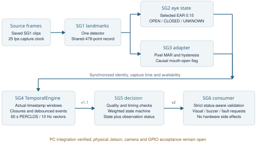

# SG5 Midterm Integration

**Rafed Aftab 457967 and Filza Umar 464340** · **G1-D2** · **28 October 2026**

This package runs SG5 independently and as part of the available driver
drowsiness pipeline. It preserves the Week 5 reference, connects actual subgroup
implementations, records reproducible evidence and provides a status-aware
handoff for SG6. The integrated PC demonstration is not proof of Jetson
deployment or real-driver accuracy.



## What connects to what

1. SG1 extracts MediaPipe face landmarks from a saved video or an explicitly requested camera.
2. SG2 uses its selected EAR method to produce eye states; the CNN checkpoint is not needed for this path.
3. A causal SG3 adapter reuses the teammate's mouth geometry and thresholds on the same SG1 landmarks.
4. The actual SG4 `TemporalEngine` aggregates synchronized cues into temporal measurements.
5. SG5 validates those measurements, updates its driver state and emits a proposed v2 packet.
6. The SG6 consumer validates the packet and produces visual, buzzer and sensor-fault requests without touching hardware.

The maintained SG4 implementation is from branch **`saman`**, not the older
`sg4` branch. The bridge preserves SG4's aggregation and event trackers. Its
native hard-state availability path does not invent confidence probabilities.
SG3's pixel geometry and causal processing corrections need owner review and
calibration; they are not a claim of unchanged or validated SG3 behavior.

## Setup on this PC

Use **Windows Python 3.11**, with the VS Code terminal at the repository root:

```powershell
cd "C:\Users\Lenovo\Desktop\7th Semester\Computer Vision\Project\SG5 tasks\Midterm"
python --version
python -m venv .venv
.\.venv\Scripts\python.exe -m pip install -r module_5/midterm/requirements-pc.txt
.\.venv\Scripts\python.exe module_1/scripts/download_model.py
```

Create the environment only if it is missing. Activation is unnecessary, so
PowerShell execution-policy changes are unnecessary. The model downloader
verifies SG1's pinned official model checksum. This is pretrained inference;
no SG5 or landmark-model training runs here.

`engine.py` and the SG6 consumer use only the Python standard library. Actual
SG4 replay also needs the packages in `requirements-core.txt`. Full vision and
plots use the tested PC pins in `requirements-pc.txt`; **that is not a Jetson
installation recipe**.

## Run the deterministic integration first

```powershell
.\.venv\Scripts\python.exe -m module_5.midterm.demo --scenario drowsy --output module_5/midterm/results/demo_drowsy
.\.venv\Scripts\python.exe embedded_6/sg5_handoff/consume.py --input module_5/midterm/results/demo_drowsy/sg6_stream.jsonl --events-only
.\.venv\Scripts\python.exe -m module_5.midterm.demo --scenario face_lost --output module_5/midterm/results/demo_face_lost
.\.venv\Scripts\python.exe embedded_6/sg5_handoff/consume.py --input module_5/midterm/results/demo_face_lost/sg6_stream.jsonl --events-only
```

Available native SG4 scenarios are `alert`, `drowsy`, `face_lost`, `noisy` and
`yawns_nods`. The runner also accepts `--sg4-input` for a native SG4 JSONL input
stream. Each output directory contains `sg4_stream.jsonl`, `sg6_stream.jsonl`
and `summary.json`. This replay executes the real SG4 engine on mock cues;
it is not a camera demonstration.

During lost or unreliable observations, the last state string is retained as
**untrusted**, alerts are suppressed and a sensor fault is requested. Do not
present that held state as a fresh NORMAL measurement.

## Run all available vision stages on the saved video

```powershell
.\.venv\Scripts\python.exe -m module_5.midterm.pipeline --video module_1/data/videos/driver_sample_01.mp4 --output module_5/midterm/results/video01 --annotated
```

Add `--show` to request an interactive preview; press Q or Escape to stop it.
Without `--show`, processing is headless. `--annotated` saves `annotated.mp4`
and example images. The runner also writes per-stage JSONL, frame timings,
example packets and a `summary.json` with source/model hashes and versions.
The video has no independent drowsiness labels: its state counts are predictions,
not accuracy, and its PC throughput is not a Jetson FPS claim.

An optional live-camera run must be explicitly selected by the operator:

```powershell
.\.venv\Scripts\python.exe -m module_5.midterm.pipeline --camera 0 --show --output module_5/midterm/results/camera_demo
```

## Reproduce the controlled comparison and tests

```powershell
.\.venv\Scripts\python.exe -m module_5.midterm.evaluate --plot
.\.venv\Scripts\python.exe -m unittest discover -s module_5/midterm/tests -v
```

Evaluation uses the same two preserved synthetic drives, 5,400 labelled rows.
Labels are explicitly excluded from decision inputs. Results and saved PNGs
are under `results/evaluation/`; plots use a headless backend and do not open
windows. Source hashes, configurations and timing scope are recorded in
`evaluation.json`.

The preserved synthetic drives use a **30-second PERCLOS window**, while actual
SG4 uses **60 seconds**. Their distributions are not interchangeable; the
thresholds still need independent evaluation on real SG4 recordings.

| Method | Overall accuracy | Drowsy episodes detected | State changes |
| --- | ---: | ---: | ---: |
| Preserved Week 5 A | 71.4% | 2/2 | 22 |
| Preserved Week 5 B | 75.2% | 1/2 | 18 |
| Preserved Week 5 C | 65.8% | 2/2 | 11 |
| Robust midterm C | 64.1% | 2/2 | 27 |
| C faster-recovery sensitivity run | 64.0% | 2/2 | 27 |

The new C state-change count includes transitions into and out of evaluation
abstention (`UNKNOWN`), so it is **not** a like-for-like flicker improvement.
UNKNOWN is an evaluation label for non-OK status, not a new legacy driver-state
enum. Invalid samples remain in the accuracy denominator.

Strict midterm event matching requires a new DROWSY onset inside its labelled
episode, one-to-one. The preserved evaluator allowed a five-second grace period
after episode end. Do not mix the two definitions. Unmatched onsets, overlap
coverage, false-DROWSY duration and sample confusion are recorded separately.
The faster-recovery setting changes WARNING entry to 0.18, exit to 0.12 and
release to 1.5 seconds; it is a sensitivity check on development data, not a
held-out winning configuration.

## SG4 input and SG6 output

The core input is SG4's six fields:

| Field | Unit |
| --- | --- |
| `time_s` | Strictly increasing capture-clock seconds within a session |
| `face_valid` | Current face availability, boolean or 0/1 |
| `perclos` | Fraction 0-1 over SG4's 60-second window, not percentage |
| `eye_closure_s` | Current ongoing eye-closure duration in seconds |
| `long_blinks` | Event count over 30 seconds |
| `yawn_count` | Event count over 60 seconds |

Optional `validity_score` is historical observation availability. The direct
bridge also carries current `eye_valid`; a currently missing eye measurement
cannot be rescued by high historical validity. Six-field legacy rows have no
such quality history and assume full quality for a valid face; this assumption
is recorded in the engine documentation.

The proposed `sg5.sg6.v2` output keeps `NORMAL/WARNING/DROWSY` and adds raw and
smoothed scores, quality, session, status, reason, configuration and alert-event
fields. Scores are engineering evidence; quality is availability, neither is a
trained probability of drowsiness. See the [SG6 handoff](../../embedded_6/sg5_handoff/README.md)
for the exact contract and hardware requests.

`to_legacy_sg6()` returns exactly `{driver_state, alert, confidence}` for status
OK. It raises for insufficient or stale evidence because the old format cannot
express that condition. The legacy `confidence` field means observation quality.
V2 acceptance and the fault indication must still be agreed with SG6.

## Timing and missing data

The default C configuration uses the retained 0.45/0.20/0.20/0.15 weights,
2-second exponential smoothing time constant, 1-second upward confirmation,
3-second lower-risk confirmation and a 1.5-second eye-closure override. Entry
and exit thresholds are different. Invalid observations and gaps reset evidence;
duplicate/backward/nonfinite timestamps are rejected. There is no forced
five-second NORMAL warm-up in the new deployment core.

Call `DecisionEngine.tick()` with the same capture clock to detect upstream
silence after 0.5 seconds. A transport that stops delivering decisions needs
SG6's independent arrival-time `DeliveryWatchdog`; replaying a file does not
itself implement a continuously running hardware watchdog. Neither watchdog
can establish a driver's true state when the sensor is unavailable.

## Evidence and remaining acceptance work

- [Report](report/SG5_Midterm_Report.pdf), [viva commands](scripts.md) and [explanations](VIVA_GUIDE.md).
- Original Week 5 code and evidence remain unchanged in the sibling baseline folder.
- SG3 adapter geometry/threshold calibration and SG4 hard-state availability handling require owner review.
- SG6 must accept v2/fault behavior and verify platform boot, libraries, camera and hardware requests on the actual Jetson.
- The two synthetic drives do not establish generalization or real-world safety. Additional independent labelled recordings are needed.
- Each member must confirm and explain their actual contribution; these documents do not invent contributions or meetings.
